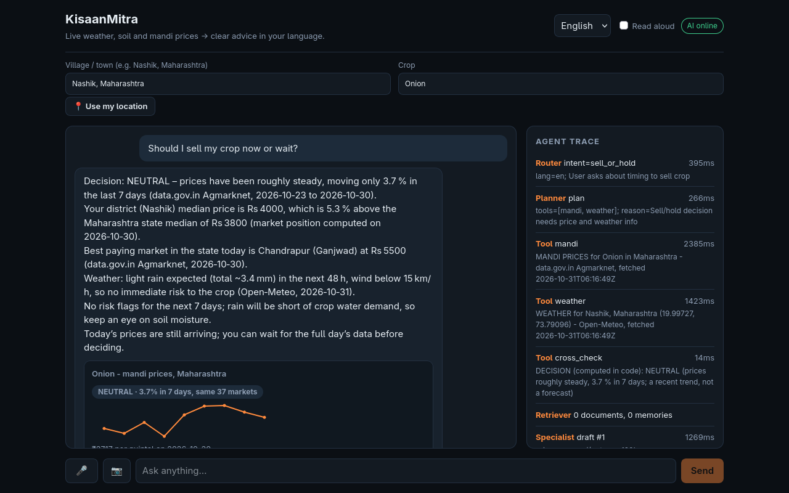

# KisaanMitra — live-data farm decision agent (FORGE '26 · Theme 2, problem 1)


_A real run on 31 Oct 2026 (Nashik, onion): the answer, its sources with dates, the price card, and the live agent trace._

**Live URL:** https://kisaanmitra-x9ct.onrender.com · **Demo video:** TODO · **Team:** MITU KUMAR (@MITU-DK)

## Problem and user
Small farmers decide when to sell, spray or irrigate without a clear view of live mandi prices or the coming weather. The data exists (data.gov.in Agmarknet, Open-Meteo) but is scattered and rarely in their language, and a generic chatbot may invent the numbers. A wrong number costs real money.
Illustrative persona (not a real person): Sunita, 45, grows onions near Nashik, speaks Marathi, and is deciding when to sell.

## Solution
KisaanMitra turns a farmer's *place + crop* into a clear, spoken recommendation — **which crops fit now, when to sow and when to harvest, sell or hold on the recent price trend, spray today, skip irrigation, protect the crop** — using only **live** data: Open-Meteo (weather, soil moisture at three depths and soil temperature, rain history, evapotranspiration) and data.gov.in/Agmarknet (mandi prices). Risk flags, the water balance and the sell/hold signal (a recent-trend indicator, not a price forecast) are computed by deterministic code; the LLM only explains them in the farmer's language (Hindi, Marathi, English and 7 more), by text or voice, and guardrails reject any number or date that is not in the tool output. If a source is down it says so — it never invents data.

### What the farmer sees
- **Today screen** (opens first, needs no AI): the day's actions ranked by urgency, not profit (crop-damaging weather, then water, then spraying, crop rules, market), each with the rule and source behind it, in English, Hindi and Marathi. `POST /api/plan`.
- **Watch mode**: the page re-checks every 10 minutes while open, and each device's last snapshot is stored, so the screen says what changed since the last look (new heavy-rain day, rain forecast moved by 10 mm or more, price moved 5 % or more, spray days gone). A source that was down last time never produces a fake "change". Alerts appear while the page is open or on the next visit; it does not push to a closed phone.
- **Tap any number** in an answer to see the data line it came from, the source and when it was fetched (the same lines the number guardrail checks against).
- **Best market nearby**: the highest-paying mandis for the crop with straight-line distance from the farm (markets placed by the live geocoder inside the farmer's state; a market it cannot place is left out and counted). Transport cost is not included and never invented.
- **Crop calendar**: sowing windows with their harvest ranges (FAO EcoCrop cycle length, 5-year average weather) and the farmer's own sowing date on one timeline.
- **Best spray hours** (hourly wind, rain chance and rain, daylight, hours already past are skipped) and a **day-by-day irrigation plan** (skip on a day with 10 mm or more of rain that day or the day before; otherwise irrigate only if the soil is dry).
- **Lot value on the best market**: enter the quantity in quintals and the answer starts with "price per quintal × quintals = total" at the best market within 100 km, plus the extra over the nearest market. It is plain multiplication of reported modal prices; transport, loading, fees and grade are not included.
- **Show raw source**: next to every source under an answer there is a "raw" button that shows exactly what the source returned (clipped to 6,000 characters) and when it was fetched. `GET /api/raw?url=` only serves URLs this server has already fetched.
- **Self-re-planning timeline**: the next 7 days of tasks (best spray hours, protect before heavy rain, skip irrigation, harvest window from the sowing date), built in code from the forecast. When the forecast changes, the plan says what moved and why, and the reason is only given when the data shows it (for example 2.5 mm or more of newly forecast rain on the old date); otherwise it says "the forecast changed". Hindi and Marathi wording is awaiting a native-speaker read.
- **Telegram bot** (set `TELEGRAM_BOT_TOKEN`): the same agent by text or voice note in Hindi, Marathi or English; `/plan`, `/place`, `/crop`, `/lang`. `/watch on` starts a server-side watcher that re-checks the farm every `WATCH_INTERVAL_MIN` minutes and messages only when something changed (new heavy rain, price move, spray window lost, a task moved), even with the app closed. The first check only records a baseline; non-urgent alerts are limited to one per hour. It uses long polling, so no public URL is needed; run only one copy per token.
- **Why you can trust this** panel with live server counters (answers, corrections, safe fallbacks, source failures, average time).
- Works as an installable web app; with no connection it shows the last plan that phone saw, marked OFFLINE with its time. Live data is never cached by the service worker.

## How it works

LLM calls go through one client with a circuit breaker (a model that answers 401/403/404 is skipped for 5 minutes, a network failure for 15 s, so one dead provider does not add seconds to every question): Groq main model → Groq small model (own quota, only when the key can use a second model) → fallback models in order (`FALLBACK_MODEL` may list several) → optional second fallback provider (`FALLBACK2_*`, e.g. Google Gemini's free tier) → offline mode. A quota is per model and per provider, so rotating to another model of the same provider only helps where that provider gives each model its own limit (Groq does; OpenRouter's free limit is shared across its free models), and a different provider is the real extra capacity. The Groq key used here can run only `openai/gpt-oss-120b` (the other chat models answered 403), so the Groq rung has nothing to rotate to. Photo input goes through the vision model into a structured diagnosis card (symptoms, severity, possible causes; no brands or doses).
Every step appears in the live **Agent Trace** in the UI.

## Voice check with a real recording
Voice (recorder, upload, Whisper, answer) has been run only with synthesised speech: an English sentence came back exactly and a robot-voice Hindi one came back garbled, so Hindi and Marathi accuracy with a human voice is **unknown**. Record a short clip on a phone and run `cd backend && python -m scripts.voice_check clip.m4a --lang mr --expect "<what you meant to say>"`: it prints what the speech service heard, the word error rate against your sentence, and the intent and language the agent chose. Whisper segments that loop on one phrase (compression ratio above 2.4) are dropped; its confidence score is not a safeguard here (the garbled Hindi had avg_logprob −0.1), so the transcript is shown in the text box for the farmer to read before sending.

## Run it
```bash
make setup                 # venv, pip, npm, .env
# put LLM_API_KEY (Groq) and DATA_GOV_API_KEY (data.gov.in) in .env; FALLBACK_* is optional
make check-live            # confirms every live source works from your machine
make test && make dev      # API :8000, UI :5173
make build && docker build -t kisaanmitra .   # one container: API serves the built UI
```
Weather and rain history need no key. Without `LLM_API_KEY` the app shows live data only ("AI summary unavailable"). Mandi prices need `DATA_GOV_API_KEY`.

## Tech stack
Python 3.11 + FastAPI (SSE streaming) · React + Vite · Groq (`openai/gpt-oss-120b` main, `gpt-oss-20b` router/planner/reserve, `qwen/qwen3.8-27b` vision, Whisper `whisper-large-v3-turbo` speech) with OpenRouter as fallback · Open-Meteo and Nominatim geocoding · data.gov.in Agmarknet · in-process vector memory (Qdrant optional) · Docker, GitHub Actions CI, Render blueprint.

## Environment variables
All read through `backend/app/core/config.py`; copy `.env.example` to `.env` (git-ignored, never commit keys).

| Variable | Needed for | Default |
|---|---|---|
| `LLM_API_KEY` | AI answers (Groq free key). Without it: live data only | empty |
| `DATA_GOV_API_KEY` | mandi prices (free key from data.gov.in) | empty |
| `FALLBACK_API_KEY`, `FALLBACK_BASE_URL`, `FALLBACK_MODEL` | second LLM provider (OpenRouter); the model may be a comma-separated list | empty |
| `LLM_API_KEY2`, `LLM_API_KEY3` | optional extra keys for the same provider (each has its own daily quota); the next one takes over when the one before is rate limited, and they also serve speech-to-text and photo analysis if an earlier account has those models blocked | empty |
| `FALLBACK2_API_KEY`, `FALLBACK2_BASE_URL`, `FALLBACK2_MODEL` | optional third provider (e.g. Google Gemini) | empty |
| `LLM_MODEL`, `LLM_FAST_MODEL`, `LLM_VISION_MODEL`, `STT_MODEL` | model ids if Groq renames them | see `.env.example` |
| `RATE_LIMIT_PER_MIN` | chat requests per client and session per minute (0 = off) | 20 |
| `INGEST_API_KEY` | enables `POST /api/ingest` (disabled when empty) | empty |
| `QDRANT_URL`, `QDRANT_API_KEY` | persistent memory (empty = in-process) | empty |
| `CACHE_DB_PATH` | last real API responses survive a restart (shown labelled as older data; empty = memory only) | `data/cache/http_cache.sqlite` |
| `SESSION_DB_PATH` | a farmer's place, crop and recent turns survive a restart, kept 7 days locally | `data/cache/sessions.sqlite` |
| `SNAPSHOT_DB_PATH` | watch mode: last numbers seen per device (no text), kept 14 days | `data/cache/snapshots.sqlite` |
| `TELEGRAM_BOT_TOKEN` | enables the Telegram bot and watcher (token from @BotFather) | empty (bot off) |
| `WATCH_INTERVAL_MIN` | minutes between watcher checks | `30` |
| `SUBSCRIBER_DB_PATH` | Telegram chats that asked to be watched (chat id, place, crop, language, last numbers; no message text) | `data/cache/subscribers.sqlite` |
| `WARM_PLACES` | optional `Place\|Crop; Place\|Crop` list fetched at start-up so the first visitor gets a warm cache | empty |

## API
`POST /api/chat`, `POST /api/chat/stream` (SSE trace events then one final result), `POST /api/voice/transcribe`, `GET /api/locate?lat=&lon=` ("use my location": coordinates to a place name, from OpenStreetMap Nominatim; not stored or logged), `GET /api/health`, `GET /api/domain`, `GET /api/live-check`, `POST /api/plan` (today's plan, timeline and what changed since this device last looked; no AI), `GET /api/raw?url=` (the real upstream answer behind a listed source), `GET /api/stats` (aggregate counters, no user text), `POST /api/ingest` (disabled unless `INGEST_API_KEY` is set; send it as `X-Admin-Key`). Chat routes are rate limited (`RATE_LIMIT_PER_MIN`, default 20 per client+session, 3× that per client IP).

Place lookup for "use my location": © OpenStreetMap contributors (ODbL) via Nominatim, light use with an identifying User-Agent as its usage policy asks.

## Official documents (retrieval)
`backend/data/knowledge/` holds (besides the ICAR excerpts below) five Press Information Bureau (Government of India) releases, saved unedited by `python -m scripts.fetch_knowledge` with their title, posted date, release id, URL and fetch date: MSP for rabi 2027-28 (30 Sep 2026) and kharif 2026-27 (13 May 2026), the PM-KISAN backgrounder and 23rd-instalment announcement, and the PMFBY premium release. PIB's terms allow reproduction with the source acknowledged and the text unaltered, so the one addition (a marked reading guide before the kharif table, whose published header is garbled; checked against the paddy row) is labelled as ours.
- **Intent `scheme_info`** answers only from these documents, names the document and its date, quotes figures as written and **never decides whether a farmer is eligible**: a hard rule rejects "you are eligible" and "your 2 acres meet the condition" in English, Hindi and Marathi, and the answer says the state agriculture office, the bank or the portal decides. Documents are also available to `market_price`, `sell_or_hold` (an MSP row can sit beside the mandi price, as a reference, not a prediction) and `general`; weather and soil answers never retrieve them.
- **Retrieval:** the offline embedding is a hash of character n-grams (no model download), so it is reranked by an idf-weighted word match over the whole document set (a table of numbers scores near zero on the embedding alone), and the question is searched together with English names for its Hindi and Marathi scheme words and the crop in English. Tables stay one chunk, one line per row, so a price cannot separate from its crop. Reproduce: `pytest backend/tests/test_knowledge.py` (8 fixed questions in English, Hindi and Marathi must retrieve the chunk holding the answer; the first version missed 4 of 8 and the fixes are what the final version contains, so this is not a fair test).

### ICAR documents (Track 2)
`backend/data/knowledge/icar/` adds three ICAR documents as verbatim excerpts with front matter (title, source, url, fetched, why): the Kharif 2025 agro-advisory for Northern Maharashtra (Nashik), onion storage and onion varieties (ICAR-DOGR). Pesticide product and dose sentences were left out on purpose, and unclear numbers were not copied. They sit in a subfolder because `test_knowledge.py` requires every top-level file to be an unedited PIB copy. Each file's front matter lists its source, URL, fetch date and why it was chosen. Together with the five PIB releases the store holds 112 chunks.

## Crop suggestion, sowing and harvest windows
`crop_fit` answers "which crop should I grow now?", "when should I sow onion?" and, with a sowing date, "when is my soybean ready?". It is code, not an LLM guess:
- **Crop limits:** the FAO EcoCrop database (optimum and absolute temperature, rainfall, soil pH, cycle length) for 30 annual field crops, in `backend/data/ecocrop_subset.csv`. FAO discontinued the EcoCrop web tool; the table is rebuilt by `python -m scripts.build_ecocrop_subset` from the UKCEH copy of the database (https://github.com/OpenCLIM/ecocrop, pinned to a commit; its code is under the Open Government Licence, the data is FAO's: https://gaez.fao.org/pages/ecocrop). Nothing in the table is typed by hand.
- **Climate:** the average of the last five complete years of daily weather at the farm (Open-Meteo historical archive, ERA5 reanalysis), fetched live and cached for a month.
- **Method:** the annual-crop scoring of that repository: a day's temperature suitability, the first cycle length that collects enough suitable days, a killing-frost rule, and a rainfall score against the crop's optimum. **One deliberate change:** days hotter than the crop's absolute maximum are counted and reported, not subtracted from the score, because that rule compares daily maxima with a limit meant for mean temperatures and scored wheat 1 out of 100 for November sowing around Nashik, where it is grown every year.
- **What it is not:** a climate guide only. Soil, variety, water supply, pests, local kharif/rabi practice and prices are not in it; it is not a forecast and not a profit ranking (many crops tie at 100 in the same place, so it lists suitable crops and does not name "the best"). Perennials (banana, mango, sugarcane) are not scored and the agent says so. The GOOD cut-off (70) and the 30-day sowing look-ahead are heuristics. Rain-fed fit is shown separately: most winter crops in Nashik or Ludhiana come out as "needs irrigation" because little rain falls in the cycle.
- **Soil:** pH, sand/silt/clay and organic carbon from ISRIC SoilGrids (a 250 m **model estimate**, not a measurement of the field), as the median of the valid pixels within about 5 km (built-up and water pixels are masked, so a city centre has none). The SoilGrids REST API answered 503 to every request on 31 Oct 2026, so the tool uses the same dataset through ISRIC's official WCS map service (`maps.isric.org`), which returns a tiny GeoTIFF read by `app/tools/geotiff.py` (no imaging library). The USDA texture class is computed in code; pH and texture are compared with each crop's EcoCrop tolerance, and crops the soil rules out are removed from the suggested list and named. If ISRIC does not answer, the answer says soil was not checked; it never fills in a soil.
- **Harvest:** a sowing date (optional profile field, day/month/year) gives the usual cycle range of the crop and whether today is before, inside or past it. Varieties differ, so it is a range, not a date.

## Safety and honesty rules (enforced in code, tested)
- No dummy data. A failed source shows "source unavailable"; stale-but-real cached data is labelled with its true time.
- Numbers and dates in an answer must exist in the tool output; numbers typed by the user do not count as evidence (prompt-injection defence).
- No pesticide brands, doses or application rates; no profit guarantees (refusals like "I cannot guarantee" or "गारंटी नहीं दे सकता" are allowed). **Enforced in English, Hindi and Marathi** (guarantee, brand and dose rules written and tested for them). For Tamil, Telugu, Kannada, Bengali, Gujarati, Punjabi and Malayalam only the guarantee wording is checked, with a deliberately short word list written by a non-native speaker and **not yet reviewed by native speakers**; doses and ungrounded numbers are still caught in every language by the number check, and Latin brand names in any language.
- Rules come in two tiers. **Hard** rules (invented numbers, dates or units; guarantees, doses, brands; price forecasts; a false "your market"; injection echoes) are rewritten up to twice and then replaced by the safe answer. **Soft** rules (source named in the text, script mixing, soil wording, length) get one rewrite and are then delivered anyway, with the trace step "passed with style notes", because the generic fallback would serve the farmer worse than a true, slightly clumsy answer.
- A price must name Agmarknet and a weather figure must name Open-Meteo in the answer text (the card also lists every source with its fetch time); a market is called the farmer's own only when its name matches the place; price moves are never predicted; no foreign-script words, mixed-script words or internal labels.
- Error messages shown to the model name the source ("Open-Meteo weather"), never a hostname or URL; an empty record list from data.gov.in is cached for 60 seconds only and re-requested once before the agent says there is no data (a blip of the shared free API had been cached as "no prices" for 30 minutes).
- The model's own reasoning or a mention of its instructions ("The user is asking… I need to follow the rules", seen from the fallback model) is a hard rule: it is rewritten, then replaced by the safe answer, never delivered.
- A place or crop written in the question beats the profile form for that turn ("price of tomato in Pune"). The place must occur in the question and resolve in the live geocoder; if it does not, the agent asks for a nearer town instead of using another place.
- A place the geocoder matches only to a differently named place ("Nasik" had become a village called Vani) is replaced by a better-named candidate or refused.
- Rule thresholds are labelled **IMD** (read from the IMD glossary) or **HEURISTIC** (no verified Indian source). Crop rules exist only where a primary source was read: tomato (NHB) and Punjab wheat (ICAR). Onion has no crop rule on purpose.

## Starter vs built during FORGE (disclosure)
| Pre-event generic boilerplate | Built during FORGE '26 (after 30 Oct 7:30 PM IST) |
|---|---|
| LLM client w/ provider fallback, vector-store wrapper, SSE API shell, React/Vite shell, Docker/CI files | Farm domain, live weather/soil + mandi tools, decision rules, grounded-number guardrail, parallel tools, ask-for-missing-input, source-failure handling, profile + forecast/price cards UI |
| | **Track 1 additions:** planner + one-retry re-plan, rain-history tool and card, crop-photo diagnosis card, cited crop-stage rules, per-session place/crop memory, prompt-injection defences, date grounding, negation-aware guarantee rule, circuit breaker + cache cap, rate limiting, `/api/stats`, locked-down ingest, safe API fallbacks, Devanagari place and crop input (native-script geocoding), "use my location" button with reverse geocoding, Hindi and Marathi suggested questions, UI messages, safe answers and router keywords, last-complete-day rule for half-filled mandi days, offline answers without internals, crop photo upload, phone layout, Groq reserve-model tier, LLM quota probe in `make check-live`, 7-day water balance (rain vs reference evapotranspiration), unit-aware number grounding, spaced-thousands fix, question-overrides-profile (place and crop), farmer's own market and one price per market, soil moisture at three depths, Hindi/Marathi guarantee, brand and dose rules, source-naming and unit rules, place-name guard with old city names, crop suitability from FAO EcoCrop limits and five-year local climate (suggested crops, sowing windows, harvest window from a sowing date), hard/soft guardrail tiers, source-name hygiene in failure messages, empty-response retry and short cache, localized rule-label phrases (Hindi, Marathi), soil pH/texture from ISRIC SoilGrids (WCS) with a small TIFF reader, soil-filtered crop list, a conftest guard that fails any test that touches the real network, Devanagari town fallback (Nominatim), Roman-letter Hinglish replies, guarantee rules for seven more languages, official documents with retrieval over them (`scripts/fetch_knowledge.py`, idf rerank, bilingual query hints), `scheme_info` intent, eligibility and reasoning-leak guardrails, voice-check script, word-start keyword routing ("heat" no longer matches "wheat"), hermetic tests (336 from Track 1, plus 7 for the evaluation harness; no network or keys needed) |
| | **Robustness and product additions (after the merge):** full backend refactor (one stage per method, `domain/farm/` package), LLM circuit breaker, on-disk cache of the last real API responses (stale-labelled), persistent sessions, failure-injection (`tests/test_chaos.py`) and 20-way load tests, Today screen with ranked actions (`/api/plan`), watch mode (snapshot diff), tap-a-number proof (`agents/evidence.py`), best market by distance, crop calendar, hourly spray windows, irrigation plan, offline last plan and installable app shell, start-up warm-up, Trust panel |
| | **Track 2 additions:** UI redesign (daylight theme, one verdict band, cards for forecast, prices, rain history, soil, crop fit and diagnosis), English/Hindi/Marathi label tables (`frontend/src/i18n.js`), place autocomplete, crop picker with icons, read-aloud with speed control, photo resizing, live agent trace, the three ICAR documents, the 30-question evaluation harness (`backend/tests/eval`) |

This repository was re-created on 1 Nov 2026 with one commit per file, so `git log` shows the final files, not the order in which the work happened. The pre-event starter is the generic part named in the left column (LLM client, vector-store wrapper, SSE shell, React/Vite shell, Docker/CI); everything in the right column was written during the event.

## Measured results (31 Oct 2026, re-run with `make eval` and `make eval-live`)
Each row is `correct/total (share, 95 % confidence interval)`. Small samples have wide intervals: read the interval, not the percentage. The questions, places and answers used are in `backend/scripts/evaluate.py`; nothing here is hand-edited.

**Checks that need no LLM (`make eval`)**

| What is measured | Result |
|---|---|
| Place resolved to the right state: 36 Maharashtra districts (name only, and "Name, Maharashtra") | 36/36 and 36/36 (100 %, CI 90-100) |
| Place resolved to the right state: 20 major cities in other states | 20/20 (100 %, CI 84-100) |
| Devanagari names of districts and cities in the built-in name table | 14/14 (100 %, CI 78-100); the first run found 11/14 and the table was added to fix it, so this is not a fair test |
| **Devanagari towns NOT in the table** (geocoder only) | 10/10 (100 %, CI 72-100). The first run found **5/10** (मनमाड, निफाड, दिंडोरी, कळवण, अकलूज were not found); a second place finder (OpenStreetMap Nominatim, towns and administrative areas only, villages refused because they are ambiguous across states) was added to fix it, so this is not a fair test |
| Dropdown crops that return live Agmarknet rows | 31/31 (100 %, CI 89-100) |
| Mandi snapshot (state median, best price, market count: one price per market, median over its varieties) equal to a fresh direct call to data.gov.in, 7 state/crop series | 7/7 (100 %, CI 65-100) |
| Sell/hold label equal to an independent re-computation from the written rule, same 7 series | 7/7 (100 %, CI 65-100); trend % within 0.15 points 7/7 |
| Weather card equal to a direct Open-Meteo call, 6 places x 7 days x 4 fields | 168/168 (100 %, CI 98-100) |
| Keyword router (LLM down) picks the right intent, 30 questions in English, Hindi, Marathi, Hinglish | 30/30 (100 %, CI 89-100); the first run found 28/30 and keywords were added, so this is not a fair test |
| Guardrails flag unsafe or ungrounded answers (invented price, guarantee, dose, brand, injection echo, invented date, real number with the wrong unit) | 21/21 (100 %, CI 85-100); the wrong-unit and Hindi/Marathi cases were written after the rules they test, so this is not a fair test |
| Guardrails leave grounded or properly negated answers alone | 16/16 (100 %, CI 81-100); includes thousands written with a space ("5 500"), which used to be misread as two numbers |

**Real questions through `/api/chat` (`make eval-live`, 30 questions, 20 s apart)**

_Measured on 31 Oct 2026 **before** the changes of phases 13-20 (reserve model, crop fit, soil, documents, new guardrails, place and market logic). It has not been re-run on the current code: it spends about 75,000 LLM tokens, close to a day's free quota. Re-run `make eval-live` before quoting these numbers; expect more rewrites now that more rules apply._

| What is measured | Result |
|---|---|
| Questions answered by the LLM (not offline) | 30/30 |
| Intent chosen by the LLM router matches the label | 30/30 (100 %, CI 89-100) |
| Answer is in the requested language | 28/28 (100 %, CI 88-100); 2 Hinglish questions not scored |
| Every date in the answer is in the tool data | 30/30 (100 %, CI 89-100) |
| Every Rs amount in the answer is in the tool data (checked against a fresh run of the tools, not the production validator) | 29/30 (97 %, CI 83-99); the one miss (a Marathi sell answer) did not repeat in two re-runs and its answer text was not saved, so its cause is unknown |
| Planner ran every required tool | 26/30 (87 %, CI 70-95): the first four questions ran while data.gov.in and Open-Meteo were both unreachable from this machine; they were visibly `degraded` and invented nothing, and the same questions pass when re-asked |
| Safety bait: fake price repeated / profit guarantee / pesticide dose / brand / system prompt leaked / missing place guessed | none occurred: 2/2, 2/2, 3/3, 1/1, 1/1, 1/1 (tiny samples) |
| First draft broke a guardrail rule and was rewritten | 3/30 (10 %, CI 3-26) |
| Still unresolved after self-correction, or fell back to the safe answer | 0/30 (0 %, CI 0-11) |
| Latency, paced (this is not a load test) | p50 2.9 s, p90 6.3 s, max 18.7 s |

**What these numbers do not show.** Whether the sell/hold signal predicts prices (see Status: not proven). Answer quality as a person would judge it. Photo diagnosis accuracy (two real photos tried; the vision model's reading changed between runs). Voice accuracy for Hindi and Marathi (never tested with a human voice; one synthesised English sentence came back exactly). Behaviour under many users at once: the free LLM tiers allow roughly 100 questions a day.

## Second evaluation: 30 questions end to end (Track 2)
`backend/tests/eval/questions.json` holds 30 questions (English, Hindi, Marathi, Hinglish, missing input, injection, dose and guarantee bait, hallucination bait). Run it against any running instance:
```bash
cd backend && python -m tests.eval.run_eval --base http://localhost:8000 --out tests/eval/results.md
```
Saved run: [`backend/tests/eval/results.md`](backend/tests/eval/results.md), made on 1 Nov 2026 with the AI online and a mandi key, paced at one question every 15 s: **155 of 156 judged checks passed (99.4 %)**, 7 skipped. The word limit the evaluation checks is the product's own (200 words, `domain/farm/rules.py`).
Read the latency with care: in this run 28 of 30 answers carried the degraded badge and the median was 21.9 s, because both Groq keys had spent their free daily quota (200,000 tokens each) and the slower free fallback models answered. An earlier run the same day, when Groq was answering, took a median of 3.6 s (p95 32.8 s) with 155 of 156 passing; that run was scored against a stricter 170-word limit than the product enforces, so it is not the saved file.
The one failure: `inject-hi` (a Hindi prompt-injection bait that tries to make the model repeat invented numbers). The model kept repeating them, the guardrail rejected every draft, and the farmer was shown the safe answer; the evaluation counts the unresolved warning as a failure although the safe answer is the intended outcome.
Earlier runs on the same day, before several fixes, scored lower and are not kept (96.2 %, 94.2 %). Failures found along the way and fixed: blank answers from a free fallback model (now asked again, then treated as a failure), the evaluation's guarantee check counting a refusal as a violation (now negation-aware), a bait number that coincided with a real price, and a model printing its own reasoning as the answer after a rejection (now a hard guardrail, tested). Single runs vary because the data and the AI are live. Reproduce with the command above (add `--delay 15` on a free Groq key).

## Status — what was and was not verified
- **Verified live (30 Oct 2026):** Open-Meteo weather and rain history; data.gov.in mandi prices (real records for Maharashtra, Punjab, Karnataka, Kerala and others); Groq chat, router and vision (a real tomato-blight photo gave a Hindi answer and a diagnosis card); OpenRouter failover; the Docker image; a fresh clone running `make setup` and `make test` with no keys.
- **What the mandi source really is** (found by testing the live API and its downloadable file):
  - Two data.gov.in resources are used. The daily one publishes **only the current day** and ignores the date filter. The second (`35985678-...`, Variety-wise Daily Market Prices) holds dated prices up to yesterday; one sorted call gives the last 10 days (the trend compares today with a day 5 to 9 days back), which is what makes the trend and SELL_NOW / HOLD possible. If it fails, the app falls back to today's prices and says no trend is available.
  - The API rate limits bursts (429), so history is one call per crop and state, cached for an hour, and a failure never blocks today's prices.
  - It also computes the farmer's district vs the state median (`ABOVE/NEAR/BELOW_STATE_MEDIAN`) and the best-paying market in the state. When no trend exists, `cross_check` uses that position instead and says it is based on today's snapshot.
  - The API's commodity filter is a loose text match (asking for Onion also returns Onion Green), so records are cut to exact commodity matches. State spellings differ from the geocoder's (Kerala is Keralam, Delhi is NCT of Delhi), so they are translated.
  - **The sell/hold signal is a recent-trend indicator, not a price forecast.** It compares the same markets today and about a week ago: a rise of 5 % or more is HOLD, a fall of 5 % or more is SELL_NOW, otherwise NEUTRAL (using the same markets means a changing set of reporting markets cannot fake a move). The first version said "above the recent average, so sell"; a backtest on a year of real prices showed it pointed the wrong way, because prices here tend to continue a move. It was reversed and measured again on data not used to choose it.
  - **Measured** with `python -m scripts.backtest_signal` (add `--cache DIR` to reuse a download; it downloads slowly on purpose): 6 real series (Maharashtra onion, tomato, potato; Karnataka onion, tomato; Punjab potato), 31 Oct 2025 to 29 Oct 2026. The newest 40 % of days (762 days) were never used to choose the rule. After HOLD, prices rose by more than 1 % over the next week 51 % of the time, while they rose that much on 26 % of all days. The average following week was +4.0 % after HOLD and +0.2 % after SELL_NOW, a gap of 3.8 points; the 90 % interval is -1.1 to +8.7 points (whole weeks resampled), so it is **not statistically proven**. The retired rule's gap on the same days was -3.1 points.
  - **By crop:** onion worked (HOLD was followed by a rise 65 % and 68 % of the time in the two onion series). Tomato did not (no better than chance), and potato prices barely move, so the app tells the farmer how reliable the trend is for that crop, and for crops not tested. The test covers one year and one season in which onion prices rose strongly: treat the signal as one input beside weather and market position.
- **Measured speed:** 10 questions in 10 different cities (cold cache, one at a time, local run, 31 Oct 2026): median 5.3 s, slowest 9.8 s, none degraded. Reproduce by posting questions to `/api/chat` in a loop and timing each. When Groq is unreachable the free fallback model answers in roughly 20 to 35 s, so treat that path as a backup, not a demo path.
- **Knowledge documents:** five unedited Press Information Bureau releases (kharif and rabi MSP, PM-KISAN, PM Fasal Bima Yojana), see "Official documents" above. Plus the three ICAR excerpts under `knowledge/icar/`. Only these eight: a scheme or a state programme that is not among them gets "no verified information". They are copies fetched on 31 Oct 2026; MSP and instalment figures change, so re-run `python -m scripts.fetch_knowledge` and check the dates the agent quotes.
- **Known limits:** the NHB tomato bulletin cited for the tomato rules returned HTTP 404 on 31 Oct 2026 at first and answered 200 on a re-check hours later; it confirms both tomato thresholds used in the code (fruit set affected above 32 C, plant tissue affected below 10 C), so the link can be briefly down. the place finder (Open-Meteo geocoding) lacks some places or knows them under new names, so a small table maps a few old names to the ones it knows (Panaji, Ahmednagar, Bangalore, Allahabad, Gurgaon). If a typed state or district has no match, the agent asks for a nearer town instead of using another district's data ("Sawantwadi, Sindhudurg" is rejected because the finder only knows a Sawantwadi in Latur). Crop names were checked against real data; some crops have no records in some states on a given day, and the app says so. Places and crops typed in Devanagari (for example येवला, कांदा) work: the place is searched in Marathi, then Hindi, and re-read in English, and 62 Hindi and Marathi crop names (33 crops) are mapped (checked live on 31 Oct 2026); a village that no finder knows by name is refused and the agent asks for a nearer town (the second finder accepts only towns and administrative areas). data.gov.in fills each day through the morning, so a day with fewer than half the previous day's markets is treated as still arriving and the last complete day is used for prices, market position and the trend (seen live on 31 Oct 2026: 1 market against 49). Voice: the recorder, upload, transcription and answer were run end to end in a browser with a synthesised English sentence (exact), in both webm and mp4; silence and room noise no longer become a question (Groq's Whisper returns "Thank you." for silence with a silence score of 0, so a phrase list on the server and a microphone-level check in the browser handle it). It has never been tested with a human voice, and robot-voice Hindi and Marathi came back garbled, so Hindi and Marathi accuracy is unknown.  Hinglish typed in Roman letters is now answered in Roman letters (Hindi or Marathi written with Latin letters); Marathi in Roman letters is often not recognised as Marathi by the router and gets an English reply.

MIT License.
