# KisaanMitra

**A live-data decision agent for Indian farmers: sell or hold, spray, irrigate, what to sow. Answered in English, Hindi and Marathi, with a source and timestamp on every number.**

[](https://github.com/MITU-DK/forge-hackathon/actions/workflows/ci.yml)
[](LICENSE)


**[Live app](https://kisaanmitra-x9ct.onrender.com)** · **Demo video: TODO** · FORGE '26 Gen-AI Buildathon, Theme 2 (Climate, Resource Infrastructure & Global Supply Resilience), Problem 1: Multilingual Agritech & Resource Advisory Assistant


_A real run on 31 Oct 2026 (Nashik, onion): the answer, its sources with dates, the price card and the live agent trace._

> The free Render plan sleeps after about 15 minutes idle, so the first request can take 30 to 60 seconds. Open the app once before testing.

---

## Contents
[Problem](#problem-and-user) · [What it does](#what-it-does) · [How it works](#how-it-works) · [Run locally](#run-it-locally) · [Deploy](#deploy-render) · [Configuration](#configuration) · [API](#api) · [Safety rules](#safety-and-honesty-rules) · [Evaluation](#evaluation) · [Limitations](#limitations) · [Data sources](#data-sources-and-credits) · [FORGE disclosure](#starter-vs-built-during-forge) · [Team](#team)

## Problem and user
Small farmers decide when to sell, spray or irrigate without a clear view of live mandi prices or the coming weather. The data is public (data.gov.in Agmarknet, Open-Meteo) but scattered and rarely in their language, and a generic chatbot may invent numbers. A wrong number costs real money.

Illustrative persona (not a real person): Sunita, 45, grows onions near Nashik, speaks Marathi, and is deciding when to sell.

## What it does
KisaanMitra turns a farmer's **place and crop** into a clear recommendation by text or voice, using only live data. Risk flags, the water balance and the sell/hold signal are computed by deterministic code. The LLM only explains them in the farmer's language, and guardrails reject any number or date that is not in the tool output. If a source is down the app says so; it never invents data.

| Capability | What the farmer gets |
|---|---|
| **Today screen** (no AI needed) | The day's actions ranked by urgency (crop-damaging weather, water, spraying, crop rules, market), each with its rule and source. `POST /api/plan` |
| **Sell or hold** | A recent-trend signal (HOLD, SELL_NOW, NEUTRAL) from the same markets today and a week ago, plus the farmer's district against the state median. It is a trend indicator, not a price forecast |
| **Best market and lot value** | Highest-paying mandis with straight-line distance; with a quantity in quintals the answer starts with price × quintals = total. Transport, fees and grade are not included |
| **Self-re-planning timeline** | The next 7 days of tasks (spray hours, protect before heavy rain, skip irrigation, harvest window), built in code. When the forecast changes it says what moved, and only gives a reason the data shows |
| **Crop suggestions and calendar** | Which crops fit now, sowing windows and harvest range, from FAO EcoCrop limits, five-year local climate and ISRIC soil estimates |
| **Voice and photo** | Ask by voice; upload a crop photo for a visual assessment (symptoms, severity, possible causes; no brands or doses) |
| **Telegram bot and watcher** | The same agent in Telegram (text and voice notes). `/watch on` re-checks the farm on a schedule and messages only when something changed |
| **Proof on every number** | Tap a number to see the data line, the source and the fetch time. A "raw" button shows exactly what the source returned |
| **Resilience** | Installable web app; offline mode shows the last plan, marked OFFLINE; a model quota or provider outage degrades visibly and never fabricates |

Languages: English, Hindi and Marathi in the interface; answers can also be written in seven more languages (see [Limitations](#limitations)).

## How it works

```mermaid
flowchart LR
  UI["React UI<br/>text, voice, photo"] -- "SSE" --> API["FastAPI<br/>/api/chat/stream"]
  API --> R["Router<br/>fast LLM + keyword fallback"]
  R --> P["Planner<br/>LLM adds tools, code validates"]
  P --> T
  subgraph T ["Live tools, in parallel"]
    W["weather + soil + ET0<br/>Open-Meteo"]
    H["rain history<br/>Open-Meteo"]
    C["crop fit<br/>FAO EcoCrop + Open-Meteo history"]
    SO["soil pH + texture<br/>ISRIC SoilGrids WCS"]
    M["mandi prices + trend<br/>data.gov.in Agmarknet"]
    BM["best market + distance<br/>Agmarknet + geocoder"]
    FP["today's plan<br/>ranked in code"]
  end
  T -- "failed source is retried once" --> X["Post-tools in code<br/>cross_check, crop_stage"]
  X --> K["Retriever<br/>official PIB and ICAR documents + session memory"]
  K --> S["Specialist LLM<br/>farmer's language"]
  S --> G{"Guardrails in code<br/>numbers, units, dates, safety"}
  G -- "violation: critique" --> S
  G -- "passed" --> A["Answer + cards + sources with timestamps"]
  G -. "still failing" .-> F["Safe fallback answer"]
  V["Photo: vision LLM"] --> R
```

Every step appears in the live **Agent Trace** in the UI.

**Design principles**
- **LLM proposes, code disposes.** Decisions (risk flags, spray windows, sell/hold, ranking) are deterministic; guardrails are code, not prompt text.
- **Grounded or silent.** Numbers and dates must exist in the tool output, or the draft is rewritten and finally replaced by a safe answer.
- **Graceful degradation.** One LLM client with a circuit breaker: Groq main model (up to three keys with separate quotas) → Groq small model → OpenRouter fallback models → optional Google Gemini → offline answer built only from real tool output.
- **One backend, one frontend.** Network calls live in `backend/app/tools/http.py` (all data) and `frontend/src/api.js` (all UI).

```
backend/app/
  agents/      orchestrator (router, planner, specialist, guardrail loop), evidence, offline mode
  tools/       live data tools: weather, mandi, soil, crop fit, best market, farm plan
  decision/    deterministic rules: weather, price, soil, crop, timeline, market ranking
  domain/farm/ persona, intents, guardrail rules, localized text
  llm/         the only LLM client, prompts
  bot/         Telegram bot and watcher
backend/tests/ 470 hermetic tests (no network, no keys) and the evaluation harness
frontend/src/  React app (Today, chat, cards, trace, trust panel), i18n for en/hi/mr
```

## Run it locally
```bash
make setup           # venv, pip, npm, creates .env from .env.example
# put LLM_API_KEY (Groq) and DATA_GOV_API_KEY (data.gov.in) in .env; FALLBACK_* is optional
make check-live      # confirms every live source works from your machine
make test && make dev    # API on :8000, UI on :5173
make build && docker build -t kisaanmitra .   # one container: the API serves the built UI
```
Weather and rain history need no key. Without `LLM_API_KEY` the app shows live data only ("AI summary unavailable"). Mandi prices need a free `DATA_GOV_API_KEY` from data.gov.in.

## Deploy (Render)
`render.yaml` is a Blueprint for a Docker web service (health check `/api/health`). In Render choose **New → Blueprint**, select this repo and enter the secrets it asks for (`LLM_API_KEY`, `LLM_API_KEY2`, `LLM_API_KEY3`, `FALLBACK_API_KEY`, `FALLBACK2_API_KEY`, `DATA_GOV_API_KEY`, optionally `TELEGRAM_BOT_TOKEN`).

- **data.gov.in and some cloud hosts:** data.gov.in refused connections from Render's IP addresses. `cloudflare/mandi-proxy.js` is a small Cloudflare Worker that forwards only `/resource/<id>` requests to data.gov.in. Deploy it and set `MANDI_BASE_URL` to its URL. It stores and changes nothing; leave `MANDI_BASE_URL` empty when the host can reach data.gov.in directly.
- **Free plan:** the service sleeps when idle (ping `/api/health` every 5 to 10 minutes to keep it awake) and its disk is ephemeral, so caches and Telegram subscribers reset on redeploy.
- **Telegram:** only one process may poll a bot token. Stop any local copy before enabling the bot on the server.

## Tech stack
Python 3.11 + FastAPI (SSE streaming) · React 18 + Vite · Groq (`openai/gpt-oss-120b` main, `gpt-oss-20b` router/planner/reserve, `qwen/qwen3.8-27b` vision, Whisper `whisper-large-v3-turbo` speech) with OpenRouter and Google Gemini as fallbacks · Open-Meteo, ISRIC SoilGrids, Nominatim · data.gov.in Agmarknet · in-process vector memory (Qdrant optional) · SQLite caches · Docker, GitHub Actions CI, Render, Cloudflare Workers.

## Configuration
All settings are read through `backend/app/core/config.py`. Copy `.env.example` to `.env` (git-ignored; never commit keys).

| Variable | Purpose | Default |
|---|---|---|
| `LLM_API_KEY` | AI answers (Groq free key). Without it: live data only | empty |
| `LLM_API_KEY2`, `LLM_API_KEY3` | Extra keys for the same provider (each has its own daily quota; the next takes over when one is spent). They also serve speech-to-text and photo analysis if an earlier account has those models blocked | empty |
| `DATA_GOV_API_KEY` | Mandi prices (free key from data.gov.in) | empty |
| `MANDI_BASE_URL` | Optional proxy for data.gov.in (see Deploy) | empty |
| `FALLBACK_API_KEY`, `FALLBACK_BASE_URL`, `FALLBACK_MODEL` | Second LLM provider (OpenRouter); the model may be a comma-separated list | empty |
| `FALLBACK2_API_KEY`, `FALLBACK2_BASE_URL`, `FALLBACK2_MODEL` | Optional third provider (Google Gemini) | empty |
| `LLM_MODEL`, `LLM_FAST_MODEL`, `LLM_VISION_MODEL`, `STT_MODEL` | Model ids if Groq renames them | see `.env.example` |
| `RATE_LIMIT_PER_MIN` | Chat requests per client and session per minute (0 = off) | 20 |
| `INGEST_API_KEY` | Enables `POST /api/ingest` (disabled when empty) | empty |
| `QDRANT_URL`, `QDRANT_API_KEY` | Persistent memory (empty = in-process) | empty |
| `CACHE_DB_PATH`, `SESSION_DB_PATH`, `SNAPSHOT_DB_PATH`, `SUBSCRIBER_DB_PATH` | SQLite files: last real API responses (shown labelled as older data), sessions (7 days), watch snapshots (14 days), Telegram subscribers | `data/cache/*.sqlite` |
| `TELEGRAM_BOT_TOKEN`, `WATCH_INTERVAL_MIN` | Telegram bot (token from @BotFather) and watcher interval in minutes | empty, 30 |
| `WARM_PLACES` | `Place\|Crop; Place\|Crop` list fetched at start-up so the first visitor gets a warm cache | empty |

## API
| Endpoint | Purpose |
|---|---|
| `POST /api/chat`, `POST /api/chat/stream` | Ask a question (the stream sends trace events, then one final result) |
| `POST /api/plan` | Today's plan, timeline and what changed since this device last looked (no AI) |
| `POST /api/voice/transcribe` | Speech to text |
| `GET /api/locate?lat=&lon=` | Coordinates to a place name (OpenStreetMap Nominatim; not stored or logged) |
| `GET /api/raw?url=` | The real upstream answer behind a listed source (only URLs this server already fetched) |
| `GET /api/health`, `/api/live-check`, `/api/domain`, `/api/stats` | Health, live source check, domain info, aggregate counters (no user text) |
| `POST /api/ingest` | Add documents; disabled unless `INGEST_API_KEY` is set (`X-Admin-Key`) |

Chat routes are rate limited (default 20 per client and session per minute, 3× that per client IP).

## Safety and honesty rules
Enforced in code and covered by tests:
- **No dummy data.** A failed source shows "source unavailable"; stale-but-real cached data is labelled with its true time.
- **Grounded numbers.** Numbers and dates in an answer must exist in the tool output; numbers typed by the user do not count as evidence (prompt-injection defence).
- **No brands, doses or guarantees.** No pesticide brands, doses or application rates; no profit guarantees. Enforced in English, Hindi and Marathi.
- **No eligibility decisions.** Scheme answers quote official documents and never say whether a farmer is eligible.
- **No price predictions.** A price move is never forecast; the sell/hold signal is labelled as a trend.
- **Two guardrail tiers.** *Hard* rules (invented numbers, dates or units; guarantees, doses, brands; price forecasts; false "your market"; injection echoes; leaked model reasoning) are rewritten up to twice, then replaced by the safe answer. *Soft* rules (source named in the text, script mixing, soil wording, length) get one rewrite and are then delivered with a style note.
- **Source naming.** A price must name Agmarknet and a weather figure must name Open-Meteo; internal parts of the system ("code", "decision") are never named as a source, in English, Hindi or Marathi.
- **Place guard.** A place in the question beats the profile; it must resolve in the live geocoder, otherwise the agent asks for a nearer town instead of using another place.
- **Labelled thresholds.** Rule thresholds are labelled IMD or HEURISTIC. Crop rules exist only where a primary source was read (tomato: NHB; Punjab wheat: ICAR).

## Evaluation
Everything below can be reproduced; nothing is hand-edited. Small samples have wide intervals, so read the interval, not the percentage.

**Checks that need no LLM** (`make eval`, 31 Oct 2026)

| What is measured | Result |
|---|---|
| Place resolved to the right state: 36 Maharashtra districts (name, and "Name, Maharashtra") | 36/36 and 36/36 |
| 20 major cities in other states | 20/20 |
| Devanagari town names not in the built-in table (geocoder only) | 10/10 (first run was 5/10; a second place finder was added, so this is not a fair test) |
| Dropdown crops that return live Agmarknet rows | 31/31 |
| Mandi snapshot equal to a fresh direct call to data.gov.in (7 state/crop series) | 7/7 |
| Sell/hold label equal to an independent re-computation (same 7 series) | 7/7 |
| Weather card equal to a direct Open-Meteo call (6 places × 7 days × 4 fields) | 168/168 |
| Keyword router picks the right intent (30 questions in English, Hindi, Marathi, Hinglish) | 30/30 (first run 28/30) |
| Guardrails flag unsafe or ungrounded answers | 21/21 (cases written after the rules they test, so not a fair test) |
| Guardrails leave grounded or properly negated answers alone | 16/16 |

**30 questions end to end** (`backend/tests/eval/questions.json`: English, Hindi, Marathi, Hinglish, missing input, injection, dose and guarantee bait, hallucination bait)
```bash
cd backend && python -m tests.eval.run_eval --base http://localhost:8000 --out tests/eval/results.md
```
Saved run: [`backend/tests/eval/results.md`](backend/tests/eval/results.md), 1 Nov 2026, AI online with a mandi key, one question every 15 s: **155 of 156 judged checks passed (99.4 %)**, 7 skipped. The one failure, `inject-hi` (a Hindi injection bait), was handled as intended: the guardrail rejected every draft and the farmer saw the safe answer, but the harness counts that warning as a failure.

Read the latency with care: in this run 28 of 30 answers carried the degraded badge and the median was 21.9 s, because both Groq keys had spent their free daily quota (200,000 tokens each) and slower free fallback models answered. An earlier run the same day, with Groq answering, had a median of 3.6 s.

**Backtest of the sell/hold signal** (`python -m scripts.backtest_signal`): 6 real price series, 31 Oct 2025 to 29 Oct 2026, the newest 40 % of days not used to choose the rule. After HOLD, prices rose by more than 1 % over the next week 51 % of the time, against 26 % of all days; the average following week was +4.0 % after HOLD and +0.2 % after SELL_NOW. The 90 % interval for the gap (-1.1 to +8.7 points) includes zero, so the signal is **not statistically proven**. Onion worked; tomato did not beat chance; potato barely moves. The first version of the rule pointed the wrong way and was reversed after this test.

**Tests:** `make test` runs 470 hermetic tests (no network, no keys); CI runs them on every push. A conftest guard fails any test that reaches the real network.

## Limitations
- The sell/hold signal is a one-week trend indicator tested on one year and one season (see above), not a forecast.
- Voice has only been verified with synthesised speech: English came back exactly, robot-voice Hindi came back garbled. Hindi and Marathi accuracy with a human voice is **unknown**. `python -m scripts.voice_check clip.m4a --lang mr --expect "<sentence>"` measures it on your own recording.
- Hindi and Marathi wording (timeline, plan, diagnosis card) has not been reviewed by native speakers. For Tamil, Telugu, Kannada, Bengali, Gujarati, Punjabi and Malayalam only the guarantee wording is checked, with a short list written by a non-native speaker.
- Photo diagnosis is a visual assessment only; the vision model's reading can change between runs.
- Soil data is a 250 m ISRIC model estimate, not a field measurement. Crop fit is a climate guide only (no variety, water supply, pests or prices).
- The place finder lacks some villages; the agent then asks for a nearer town.
- Free LLM tiers allow roughly 100 questions a day, so heavy use degrades to slower fallback models.
- The live 30-question evaluation (`make eval-live`, an earlier version of the harness) has not been re-run on the latest code.

<details>
<summary><b>Details: data sources, mandi behaviour, crop-fit method, official documents</b></summary>

**Mandi prices (data.gov.in Agmarknet).** Two resources are used. The daily one publishes only the current day and ignores the date filter. The second (Variety-wise Daily Market Prices) holds dated prices up to yesterday; one sorted call gives the last 10 days, from which the trend compares today with a day 5 to 9 days back. If it fails, the app falls back to today's prices and says no trend is available. The API rate limits bursts (429), so history is one call per crop and state, cached for an hour. A day with fewer than half the previous day's markets is treated as still arriving and the last complete day is used. Records are cut to exact commodity matches, and state spellings are translated (Kerala is Keralam in the dataset).

**Crop fit.** `crop_fit` is code, not an LLM guess: limits from the FAO EcoCrop database for 30 annual field crops (`backend/data/ecocrop_subset.csv`, rebuilt by `python -m scripts.build_ecocrop_subset` from the UKCEH copy of the database), the average of the last five complete years of daily weather at the farm (Open-Meteo archive, ERA5), and the annual-crop scoring of that repository with one deliberate change: days hotter than the crop's absolute maximum are counted and reported, not subtracted, because that rule scored wheat 1 out of 100 for November sowing around Nashik, where it is grown every year. Many crops tie at 100 in the same place, so it lists suitable crops and does not name "the best". Perennials are not scored.

**Soil.** pH, sand/silt/clay and organic carbon from ISRIC SoilGrids via the official WCS map service, read by a small GeoTIFF reader (`app/tools/geotiff.py`), as the median of valid pixels within about 5 km. Texture class is computed in code. If ISRIC does not answer, the answer says soil was not checked.

**Official documents.** `backend/data/knowledge/` holds five unedited Press Information Bureau releases (MSP for rabi 2027-28 and kharif 2026-27, PM-KISAN, PMFBY premium rates) saved by `python -m scripts.fetch_knowledge` with title, date, URL and fetch date, plus three ICAR excerpts (Kharif 2025 agro-advisory for Northern Maharashtra, onion storage, onion varieties), 112 chunks in total. Pesticide products and doses were left out of the ICAR excerpts on purpose. The `scheme_info` intent answers only from these documents. Retrieval reranks a hash-n-gram embedding with an idf-weighted word match; tables stay one chunk so a price cannot separate from its crop. MSP and instalment figures change, so re-run the fetch script and check the dates the agent quotes.

**LLM ladder.** A model that answers 401, 403 or 404 is skipped for 5 minutes and a network failure for 15 seconds, so one dead provider does not slow every question. Quota is per model and provider: rotating models helps only where the provider gives each model its own limit (Groq does; OpenRouter's free limit is shared).

</details>

## Data sources and credits
- Weather, soil moisture, rain history, evapotranspiration: [Open-Meteo](https://open-meteo.com)
- Mandi prices: [data.gov.in](https://data.gov.in) Agmarknet (Government of India open data)
- Soil: [ISRIC SoilGrids](https://www.isric.org/explore/soilgrids)
- Crop limits: FAO EcoCrop, via the [UKCEH/OpenCLIM copy](https://github.com/OpenCLIM/ecocrop)
- Official documents: Press Information Bureau (Government of India), ICAR
- Place lookup: © OpenStreetMap contributors (ODbL) via Nominatim, light use with an identifying User-Agent

## Starter vs built during FORGE
| Pre-event generic boilerplate | Built during FORGE '26 (after 30 Oct 7:30 PM IST) |
|---|---|
| LLM client with provider fallback, vector-store wrapper, SSE API shell, React/Vite shell, Docker and CI files | Everything farm-specific: the domain package, live weather, soil and mandi tools, decision rules, grounded-number guardrails, planner and parallel tools, crop fit, best market and lot value, timeline, Telegram bot and watcher, voice and photo flow, Hindi/Marathi support, official-document retrieval, the evaluation harness, tests and the redesigned UI |

This repository was re-created on 1 Nov 2026 with one commit per file, so `git log` shows the final files, not the order in which the work happened. The pre-event starter is the generic part in the left column; everything in the right column was written during the event.

## Team
MITU KUMAR ([@MITU-DK](https://github.com/MITU-DK)) and MANISH SHORYAN

## License
[MIT](LICENSE)
